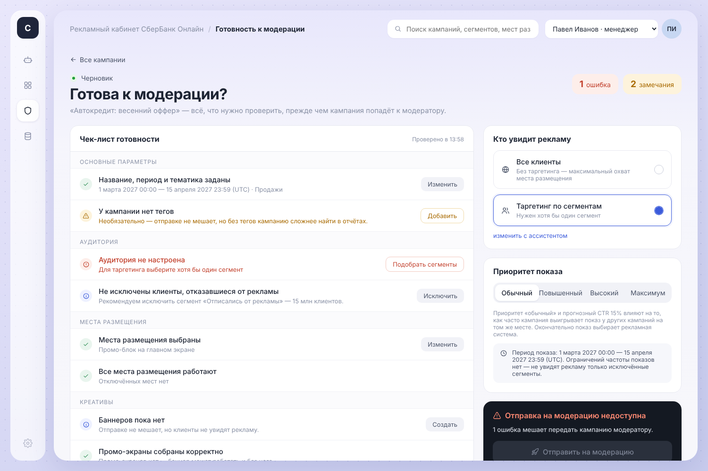
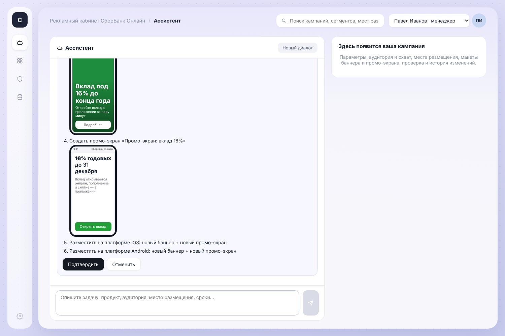

# sber-ad-api-engine

SibКод · кейс 1 · команда SUPh. AI-ассистент для заведения рекламных кампаний в СберБанк Онлайн: менеджер пишет бриф, агент собирает кампанию в доменной модели заказчика (шапка, сегменты, места показа, баннер, PROMO-экран, креативы), проверяет JSON по схемам, показывает превью и после подтверждения отправляет на модерацию. Контракт API, жизненный цикл и моки — из `docs/task.md` и `docs/mock-data.md`.



## Запуск

```bash
cp .env.example .env          # ключ GigaChat (см. раздел GigaChat)
docker compose up --build
```

| Сервис | Адрес |
| --- | --- |
| Интерфейс | http://localhost:3000 |
| Pangolin DB | localhost:5432, база `adcamp` (образ — `PANGOLIN_IMAGE`, по умолчанию совместимый PostgreSQL 16) |
| AI-агент | http://localhost:8000 (`/docs` — Swagger, `/tools` — схемы инструментов) |
| API кампаний | http://localhost:8080 |

**Вход:** `client` / `client` — менеджер кампаний, `moder` / `moder` — модератор (учётки в `data/mock/users.json`, пароли — SHA-256). Роль берётся из токена входа, подменить её из браузера нельзя; агент проверяет токен у API (`/auth/me`) и действует от имени вошедшего.

Без ключа LLM всё, кроме ответов модели, работает: API, справочники, список кампаний, превью, аудит.

Локально без Docker:

```bash
cd api   && MOCK_DIR=../data/mock go run ./cmd/server
cd agent && pip install -r requirements.txt && API_URL=http://localhost:8080 uvicorn app.server:app --reload
cd web   && npm install && npm run dev
```

## Тесты

```bash
cd api   && go test ./...                                   # жизненный цикл, роли, валидации, сверка с моками
cd agent && python -m unittest discover -s tests -t .      # валидаторы + 4 сквозных сценария на живом API
```

Агент также проверяет запросы и тексты креативов на соответствие законодательству РФ о рекламе (38-ФЗ): запрещённые темы получают вежливый отказ ещё до обращения к модели, а креатив с нарушением не попадает в план.

Сквозные сценарии агента поднимают Go API сами (нужен Go) и гоняют настоящий код агента, заменив LLM скриптом. `WRITE_DIALOGS=1` пишет стенограммы в `docs/dialogs/` — это три воспроизводимых диалога из §8 ТЗ: бриф → модерация, правка отклонённой кампании, объяснение запретов жизненного цикла.

## Как это устроено

```
web (React + TS) ──/chat, /confirm──▶ agent (Python) ──REST + X-User/X-Role──▶ api (Go) ──▶ Platform V Pangolin DB
       └──────────────── справочники, кампании, аудит (чтение) ────────────────────▶ api
```

**API (Go)** повторяет поверхность §3 ТЗ: 7 справочников, `POST /places` и `/tags`, 22 операции с кампаниями и дочерними сущностями, `GET /warnings`, `GET /audit`, заглушка CBRO. Роль проверяется первой (`ROLE_FORBIDDEN`), затем состояние (`*_NOT_ALLOWED`). Ошибки — `400 {"errors":[{code,message,field}]}`, ссылки на несуществующее — `404 ENTITY_NOT_FOUND`. Каждая пишущая операция и переход статуса пишется в аудит с diff изменённых полей. Хранение — **Platform V Pangolin DB** (PostgreSQL-совместимая СУБД СберТеха): схема по доменной модели ТЗ, ограничения целостности в самой БД, каждая запись — одной транзакцией, пустая БД заполняется моками заказчика. Подробно — [`docs/database.md`](docs/database.md).

**Агент (Python)** — tool calling: по инструменту на каждый вызов API (`docs/tools.json`). Гарантии держит код, а не промпт:

1. Пишущие инструменты не вызывают API — они ставят шаг в план. План уходит в интерфейс карточкой с превью и выполняется только после кнопки «Подтвердить».
2. JSON баннера и PROMO, enum и id проверяются локально до постановки в план (`app/validators.py`); ошибка возвращается модели на исправление.
3. Шаги плана связываются ссылками (`ref: "camp"` → `"$camp"`), поэтому «создать кампанию + сегменты + баннер + экран + креативы» — одно подтверждение.
4. Ошибки и warnings бэкенда переводятся в объяснение + подсказку исправления (`app/explain.py`).
5. Частичная правка — `GET → слияние → PUT` полного объекта, как требует семантика PUT.
6. Журнал действий агента (кто, что, когда) — в состоянии сессии; серверный аудит — в API.

LLM — за слоем абстракции (`app/llm.py`): `LLM_PROVIDER=gigachat` (нативный API GigaChat, модель заказчика) или `openai` (любой OpenAI-совместимый API). Промпт — `agent/prompts/system.md`.

### GigaChat

По умолчанию — `GigaChat-3-Ultra` через единый адрес `https://api.giga.chat/v1`, вызов инструментов через `functions` / `function_call`. В `.env`:

```env
LLM_PROVIDER=gigachat
GIGACHAT_AUTH_KEY=<ключ авторизации>          # или GIGACHAT_CLIENT_ID + GIGACHAT_CLIENT_SECRET
GIGACHAT_SCOPE=GIGACHAT_API_PERS
LLM_MODEL=GigaChat-3-Ultra
GIGACHAT_CA_BUNDLE=/certs/russian_trusted_root_ca.crt   # или GIGACHAT_VERIFY_SSL=0 на демо
```

Проверка ключа одной командой: `cd agent && python gigachat_check.py` — получит токен, покажет доступные модели и проверит вызов функции. Особенности GigaChat, которые учитывает адаптер: у физлица (в т.ч. Freemium) один поток — запросы идут строго по очереди, ответ 429 повторяется с растущей паузой, а если лимит не отпускает, ассистент просит повторить сообщение вместо ошибки сервера; адрес API выбирается из `api.giga.chat` и `gigachat.devices.sberbank.ru` — первый доступный; одна функция за ответ (агент делает до `AGENT_MAX_STEPS=30` шагов), результат функции — только JSON-объект, токен живёт ~30 минут и обновляется по 401. Протокол покрыт тестом с эмулятором (`tests/test_gigachat.py`).

**Кабинеты по ролям.** Менеджер (`client`): Ассистент, Кампании, Готовность к модерации, Статистика, Аудитории и размещение, Настройки. Модератор (`moder`): Очередь модерации, Все кампании, Статистика, Настройки — без переписки с ассистентом (агент отклоняет его запросы на сервере). **Настройки:** тема (светлая, тёмная, как в системе), компактный режим, меньше анимации, примеры запросов, очистка истории диалогов, профиль и выход.

**Интерфейс (React)** — боковое меню плавно раскрывается при наведении и показывает подписи разделов; полностью на русском, языком маркетолога: никаких технических кодов, статусов-констант и JSON. Статусы («Черновик», «На модерации», «На доработке», «Одобрена», «Запущена»), форматы («Сторис», «Смарт-баннер», «Промо-экран»), сегменты и места размещения показываются по названиям из справочников; словарь и функция `humanize()` — `web/src/ru.ts`. Ассистент получает то же правило в промпте (раздел «Язык»), а сообщения об ошибках в `data/mock/validation_rules.json` переписаны простыми словами. Оболочка с боковой панелью и верхней строкой (поиск, выбор роли «менеджер» / «модератор») и четыре экрана:

- **Готовность к модерации** — главный экран кампании. Чек-лист по разделам «Основные параметры», «Аудитория», «Места размещения», «Креативы», «Статус»: ошибки блокируют отправку, замечания — нет; у каждого пункта кнопка, которая передаёт задачу ассистенту уже в контексте кампании. Справа — «Кто увидит рекламу» (все клиенты или таргетинг по сегментам с охватом), период показа и тёмная карточка действия: «Отправить на модерацию» становится доступна, когда ошибок нет и замечания подтверждены галочкой; у модератора — «Одобрить» / «На доработку» (форма с готовыми причинами и комментарием для менеджера), после одобрения — «Запустить кампанию», для идущих показов — «Остановить показы» (с подтверждением); остановленную кампанию менеджер может «Запросить возобновление» — она уходит модератору с пометкой «запрос на возобновление показов», после «Разрешить» менеджер снова запускает показы. Ниже — «Как увидит клиент» (макет телефона) и «История изменений». Логика чек-листа — `web/src/checklist.ts`.
- **Ассистент** — чат с **историей диалогов** (кнопка «История»: любой прошлый диалог можно открыть и продолжить; агент хранит ленту в `SESSIONS_FILE`, поэтому она переживает перезагрузку страницы, ошибку модели и перезапуск контейнера), карточка «Что сделает ассистент» с превью сторис/баннера и промо-экрана, кнопки «Подтвердить» / «Отменить» (после отмены ассистент спрашивает, что не так, и пересобирает план по ответу); справа — собранная кампания.
- **Кампании** — список с поиском, статусами и периодом показа.
- **Статистика** — переключатель «День / Неделя / Месяц / Весь период» (за день — график по часам); по каждой кампании: аудитория, охват, показы, клики и CTR, целевые действия, динамика по дням (с таблицей), разбивка по возрасту, полу, городам, платформам и местам размещения. Для запущенных и остановленных — факт за прошедшие дни, для остальных — прогноз на весь период. Фактической статистики в моках заказчика нет, поэтому цифры моделируются детерминированно из аудитории и размещения кампании (`api/internal/service/stats.go`, `GET /campaigns/{id}/stats`).
- **Аудитории и размещение** — сегменты с охватом, места размещения, форматы баннеров (только просмотр).



## Структура

| Папка | Содержимое | Владелец |
| --- | --- | --- |
| `api/` | Go: домен, валидации, сервис, HTTP, тесты | Go / Backend |
| `agent/` | Python: агент, инструменты, валидаторы, LLM-провайдеры, промпт, тесты | Python / AI Agent |
| `web/` | React + TypeScript | JS / Frontend |
| `data/mock/` | Моки заказчика + восстановленные справочники (см. `data/README.md`) | DevOps / Data |
| `docs/` | ТЗ, описание моков, схемы инструментов, стенограммы диалогов | все |
| `docker-compose.yml`, `.env.example` | Запуск | DevOps / Infra |

## Что проверено и что нет

- Go: `go vet`, `go test` — зелёные; warnings всех кампаний из моков совпадают с `campaign_warnings.json`, все 14 кампаний проходят валидацию.
- Агент: 10 юнит-тестов валидаторов и 4 сквозных сценария на живом API — зелёные.
- Интерфейс: собран esbuild, типы проверены tsc, пройден в браузере: бриф → план → подтверждение → проверка; кампания с блокерами; смена веса с записью в аудит; отправка на модерацию → одобрение модератором → активация.
- **Не проверено**: ответы настоящей LLM (в среде разработки не было ключа и доступа к PyPI/npm), `vite build` и Docker-образы. Первое, что стоит сделать команде, — `docker compose up --build` и прогон диалога на реальной модели.

## Расширения сверх MVP

Правило двух рук (`TWO_HANDS_RULE`: модератор не одобряет кампанию, которую сам последним правил), коды `SEGMENT_NOT_FOUND` и `SEGMENT_DUPLICATE`, проверка, что смена типа баннера не ломает привязанные креативы.
